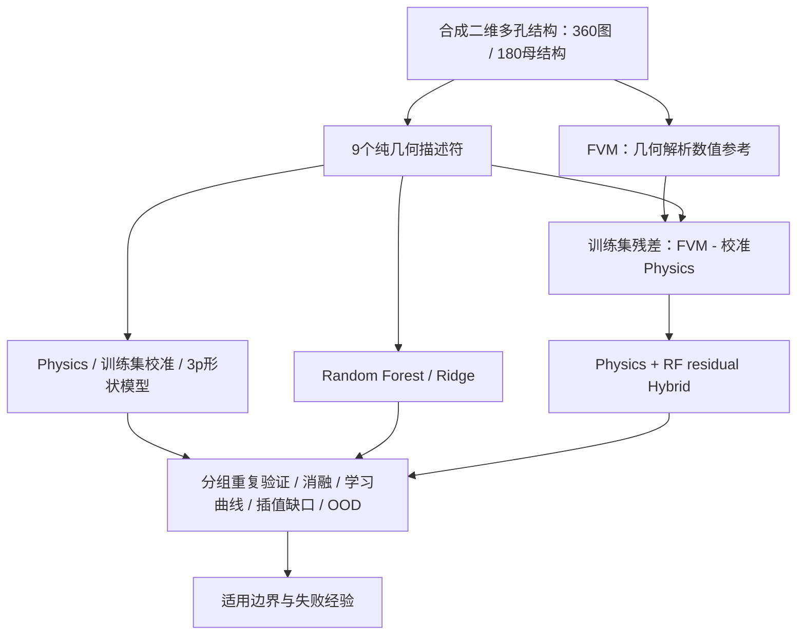

# Porous Thermal AI

Physics + machine learning for thermal transport in complex porous structures.

**气凝胶启发的二维多孔介质导热预测：物理模型、机器学习与混合模型的适用边界。**

这是二维数值方法验证，不是实验气凝胶热导率预测，也不是PINN。
完整[技术报告](reports/Final_Technical_Report.md)、[复现说明](MAC_REPRODUCE.md)、[代码导读](CODE_WALKTHROUGH.md)。

## Why this project?

孔隙率相同，沿热流方向的骨架贯通与瓶颈仍可不同。有效介质公式计算快、数据要求低，却省略几何路径；RF可以利用结构，但可能在外推中失败。本项目比较简化误差和适用范围，不预设Hybrid胜出。

## Scientific question

哪些结构信息改善导热预测？Physics、Pure ML与残差Hybrid在已覆盖分布、未见中间孔隙率及真正外推/结构族迁移中，分别何时可信？

## Method



固定相导热率比100，孔相为1；预测与误差单位都是无量纲k/k_p。
所有标签由FVM计算，Bruggeman没有生成训练标签。模型参数只由训练集拟合。

## Key results

| Prediction domain | RF MAE | Hybrid MAE | Porosity Physics | Structure Physics (3p) |
|---|---:|---:|---:|---:|
| Grouped in-distribution, 10 splits | 1.657 ± 0.243 | 1.684 ± 0.298 | 5.131 | 2.632 |
| Held-out middle φ=0.60 | 2.888 | **1.417** | 3.228 | 2.642 |
| True high-φ=0.90 extrapolation | 0.897 | 0.391 | **0.125** | 0.123 |
| Unseen anisotropic family | 4.512 | 4.937 | 8.254 | **3.175** |

全结构RF从孔隙率-only的4.817降至1.657；只加孔尺度/界面为4.924，没有改善。
贯通、方向和路径信息是主要增益。历史5划分4.881→1.630保留为历史，不与最终10划分混写。

## Main conclusion

**There is no universally best model.** RF与Hybrid在同分布相近；Hybrid在本次中间层缺口有效，却没有稳定小数据优势。高φ相极限下解析Physics更稳；未知方向族需要包含方向关系的物理形式，原孔隙率Physics反而较差。


## Repository structure

```text
configs/                     冻结参数、种子
src/data, features, physics/  合成结构、几何描述符、EMT与FVM
src/models, phase3/          固定RF/Ridge与实验执行
scripts/                     从这里运行
 tests/                      解析极限、分组和标签隔离检查
 data/raw/                   外部数据本地存放；Git忽略
 data/interim/               本地生成几何缓存；Git忽略
 data/processed/             本项目No.1样本表
 references/frozen_phase3/   不可覆盖的49行/70计划参考
 results/phase3/             数值CSV和自动PNG/PDF
 reports/                    最终报告源文与PDF
 docs/                       来源、许可、课程验收、复现证据
```

## Quick Start

Mac/Apple Silicon，Python3.12：

```bash
git clone https://github.com/Forever61T/porous-thermal-ai.git
cd porous-thermal-ai
python3.12 -m venv .venv
source .venv/bin/activate
python -m pip install -r requirements.txt
python scripts/run_all.py
```

初学者请先读[逐步说明](MAC_REPRODUCE.md)。8个直接依赖，无GPU、深度网络或大型MLOps。

## Expected output

360个FVM标签、70个划分计划、49行汇总、消融/数据量/区域诊断图和9项测试。
最后应出现`FULL_REPRODUCTION_PASS`；实际证据存到`results/reproduction/<timestamp>/`。
报告PDF是审阅过的交付文件；run_all重建数据/模型/科学图表，**不自动重排最终报告PDF**。

## Reproducibility

MacBook Air M4、macOS27.0、Python3.12.14、CPU。
原完整本地干净环境流程约43.4秒（含第三方Excel审计，不含安装），9测试通过，49指标行/70划分与冻结参考一致。
公开版默认仅运行完整No.1科学流程，不需要下载外部数据；首次独立公共版运行实测38.5秒，证据见`docs/evidence/public_no1_replay.json`。

10次同分布分组留出；固定外推区域的10个seed只改变森林，不能当10个独立OOD。CI跑解析/泄漏单元测试，完整数值复现以M4记录为准。

## Data

可公开：我们生成的合成No.1表、配方规则、FVM标签、分组计划、结果与原图。
未上传：第三方论文PDF、SI、作者仓库、真实实验Excel及逐行处理结果。
真实数据库检查是可选附加流程，下载来源/哈希见[external sources](docs/external_sources.md)。
默认不执行下载，不改原始数据。完整[license audit](OPEN_SOURCE_LICENSE_AUDIT.md)。

## Citation

本项目软件元数据见[CITATION.cff](CITATION.cff)。引用版本v1.0.0及实际commit；未申请DOI。

## License

原创代码：MIT。[合成数据、原始图表、报告/文档：CC BY4.0](LICENSE-DATA.md)。第三方材料各自许可不受本项目许可覆盖。

## Acknowledgements

物理/结构动机来自Bruggeman、Wei等形貌导热工作；工程思路参考Moosavi等母结构分组、MAST-ML和OpenPNM；RF/Ridge使用scikit-learn。
详见[归属说明](docs/external_sources.md)。代码和文稿由Codex辅助实现与整理；提交者仍需阅读、核对并按课程要求披露，不声称由学生手工独立编写全部代码。
