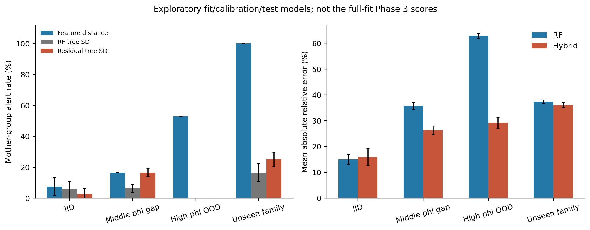

# 气凝胶启发的二维多孔介质导热预测

## 摘要

多孔绝热材料的导热预测常以孔隙率作为主要输入，但相同孔隙率下的骨架连通和方向差异仍可能改变传热路径。本工作生成360幅二维二值结构，以有限体积法计算稳态有效导热率，比较Bruggeman有效介质模型、校准及三参数结构物理模型、随机森林和物理模型加残差学习的混合模型。10次母结构分组留出中，加入结构描述符后，随机森林的平均绝对误差由4.817降至1.657；混合模型为1.684，未显示稳定的小数据优势。留出中间孔隙率φ=0.60时，混合模型误差为1.417，低于随机森林的2.888；在φ=0.90外推中，原有效介质模型误差为0.125，低于随机森林和混合模型。未见各向异性结构族时，三参数结构物理模型误差为3.175，优于两种森林模型。结构信息的预测收益主要来自贯通和方向关系，各模型的相对误差随预测区域变化。上述结果适用于固定两相导热率的理想二维问题，真实气凝胶数据库的有限趋势不能构成严格外部验证。

关键词：多孔介质；有限体积法；有效介质理论；随机森林；残差学习；模型适用域

## Abstract

Porosity alone does not specify the conduction paths in porous insulating materials. This study generates 360 binary two-dimensional structures and calculates their steady effective conductivity using the finite volume method. Bruggeman effective-medium predictions, calibrated and three-parameter structural physics models, random forests, and an additive physics-plus-residual model are compared under group-based evaluation. Across ten mother-structure splits, incorporating structural descriptors reduces the random-forest mean absolute error from 4.817 to 1.657. The residual hybrid gives 1.684 and shows no consistent small-data advantage. When the intermediate porosity of 0.60 is withheld, the hybrid error is 1.417, compared with 2.888 for the direct forest. For extrapolation to porosity 0.90, the uncalibrated effective-medium model gives an error of 0.125, lower than both forest models. On the unseen anisotropic family, the three-parameter structural physics model gives the lowest error among these models, at 3.175. All errors are dimensionless in conductivity normalized by the pore-phase conductivity. Spanning paths and orientation provide information that porosity omits, but their predictive benefit depends on the target domain. The benchmark represents an idealized two-dimensional conduction problem; the limited experimental aerogel trends do not establish simulation-to-experiment transfer.

Keywords: porous media; finite volume method; effective medium theory; random forest; residual learning; applicability domain

# 1 绪论

## 1.1 研究背景与问题定义

气凝胶的绝热性能与孔隙率、骨架形态和应用条件有关。用于节能玻璃的纤维素气凝胶研究将材料结构与透明性、绝热性能联系到具体应用[1]。对材料设计而言，需要判断某种孔结构是否可能降低导热，而不是只建立密度或孔隙率与性能之间的经验拟合。

在固定两相导热率时，相同孔隙率可以对应连续骨架、孤立团簇或沿不同方向排列的结构。简单有效介质模型用相比例代替空间分布，难以区分这些情况。逐格数值求解能够保留几何路径，但每个新结构均需计算温度场。结构描述符与机器学习可作为数值解的代理，已有工作讨论了多孔形貌信息对导热预测的作用[2]。代理模型在训练分布内误差较小，并不意味着它能够预测未见的孔隙率或结构类型。

本工作关注两个问题：哪些几何信息能够补充孔隙率模型遗漏的导热路径；物理模型、直接机器学习和残差混合模型在不同预测区域内分别有多大误差。后一个问题决定了模型是否适合用于新的候选结构，不能由一次随机划分的R²回答。

## 1.2 研究对象与工作范围

为隔离结构因素，采用固定固孔导热率的合成二维结构，并独立求解稳态Fourier导热方程。数据不来自真实气凝胶SEM或CT，孔尺度以像素表示，固相也没有指定为某种实测材料。FVM标签用于比较约化物理模型与几何解析数值解，本文不将其作为实验真值。

研究以母结构分组避免旋转对跨越训练与测试，设置结构消融、训练数据量、中间孔隙率留出、高孔隙率外推和结构族迁移。物理模型及RF超参数沿用冻结方案；另以轻量训练域距离和森林离散度作探索性风险诊断，未改变主实验参数，也未增加CNN。Wei等的形貌导热研究[2]提供了选题动机，其原始QSGS/FEM数据并未取得，本文的高斯几何、FVM边界和标签均由本项目生成。

# 2 数据与方法

## 2.1 二维结构与描述符

在64×64网格上生成白噪声，经Gaussian滤波得到相关场，再按场值排序划分固孔两相。目标孔隙率为0.30、0.45、0.60、0.75和0.90；fine、coarse及anisotropic三族滤波长度分别为(2,2)、(4,4)、(1.3,5)像素。每个组合生成12个母结构，保留原图及90°旋转图，共180个母结构、360个样本。固相像素数按比例取整，实际孔隙率重新统计。滤波的wrap约定仅用于几何生成，传热边界并非周期边界。

9项输入只读取二值图像：孔隙率、界面密度、孔尺度代理、方向参数、固相贯通比例、最大孔簇比例、截面瓶颈、截面变异系数和固相直通行比例，不使用温度、热流或真实k。固相贯通按四邻接定义，取连接左右边界的固相像素与固相总像素之比；瓶颈为列固相比例的最小值除以均值；方向参数为(I_y−I_x)/(I_y+I_x)，其中I_x、I_y为两个方向的相邻像素相变比例。孔尺度代理取孔像素距离变换均值的两倍，图像边缘补固相。它们近似表达路径、截面和方向，不等于实测纳米孔径或三维曲折度。

## 2.2 有限体积数值参考

固相k_s=100、孔相k_p=1，相导热率比固定为100。求解二维稳态Fourier导热方程[7]：

$$
\nabla\cdot[k(x,y)\nabla T(x,y)]=0.
$$

左边T=1、右边T=0，上下绝热。每个原像素细分为2×2控制体，FVM网格为128×128。内部面采用谐均值2k_i k_j/(k_i+k_j)，对应两个半格热阻串联，定温边界也计入半格热阻。稀疏系统给出温度场，由总入热流Q计算：

$$
k_{eff}=\frac{Q L}{W\Delta T},\qquad \Delta T=1,\quad L/W=1.
$$

导热率和误差均以无量纲k/k_p表示。FVM从几何和相物性独立计算，Bruggeman未参与标签生成。数值参考只对应这一理想边值问题，不是实验测量。

均匀相、串联层与并联层有解析解自动检查。360标签最大相对通量不平衡约2.14×10⁻¹¹。30个预选结构（每族、每φ、两个方向的replicate00）作64/128/256格细化，128相对256差异中位0.608%、最大1.962%。细化保持像素几何；守恒不等于全面网格收敛，30例也不能代替360例收敛检查。

**图2.1 二维结构生成、FVM参考和模型比较流程。测试标签只用于评价。**

## 2.3 物理模型及校准

依据Bruggeman自洽思想[3]采用二维各向同性形式：

$$
(1-\phi)\frac{k_s-k}{k_s+k}+\phi\frac{k_p-k}{k_p+k}=0.
$$

输入为φ、k_s与k_p，k为有效导热率。该模型用平均介质替代空间路径，同φ结构给出同一预测；它保留纯相极限，省略贯通及方向关系。

校准模型将分母中的k替换为ak。a为有效形状参数，a=1恢复原模型；在各训练子集内以MSE拟合一个全局a，范围为0.02至50。校准吸收平均偏差，仍不能区分同φ结构。已有三参数结构控制进一步采用：

$$
a(x)=\exp\{\mathrm{clip}[\theta_0+\theta_1\,anisotropy+\theta_2(bottleneck-0.5),-4,4]\}.
$$

θ只由训练集最小二乘拟合，各参数限于[−4,4]。这是带形状动机的半经验参数化，不是严格推导的孔形定律。Lu等的工作[5]提供学习形状参数扩展EMT的思路，本项目没有采用其神经网络。串联1/[(1−φ)/k_s+φ/k_p]和并联(1−φ)k_s+φk_p作为物理界限检查。

## 2.4 机器学习与残差模型

RF采用scikit-learn[8]实现[4]，固定128棵树、叶节点至少3样本、单CPU线程。它用9项结构描述符直接预测k；Ridge以α=1作为简单控制，标准化只在训练侧拟合。另保留训练均值基线，未作超参数搜索。

Hybrid先在训练侧校准Physics，再计算：

$$
r_{train}=k_{FVM}-k_{Physics,cal}.
$$

残差RF与直接RF使用相同9项输入和容量。测试时只计算物理值与预测残差：

$$
\hat{k}_{Hybrid}=k_{Physics,cal}+\hat{r}_{RF}(x).
$$

连续物理主干描述总体趋势，RF承担结构约化误差。它是加性残差混合模型，不是PINN，没有PDE残差损失，也没有对总输出施加硬守恒或正值约束。

## 2.5 划分和评价

同一母图的两个旋转方向作为一组，两幅不跨训练与测试。10次留出种子为20261013至20261022，每次144个母结构训练、36个测试。训练池25%、50%、75%和100%分别取36、72、108和144个母结构，按组嵌套，同一次划分的测试集固定。

消融使用A0仅φ、A1为φ加孔尺度与界面、A2为全9项，并保留预设的特征移除和测试置乱。中间层完全留出φ=0.60，训练取0.30、0.45、0.75及0.90，属于φ范围内的数据缺口；高φ测试以φ≤0.75训练、φ=0.90测试；结构族测试以fine/coarse训练、anisotropic测试。固定区域的10种子只改变森林，不能当10个独立OOD试验。

采用MAE、RMSE、R²的均值与标准差，负R²保留。首seed对测试母图作配对bootstrap，区间只针对已拟合模型和当前区域。重复留出的测试组有重叠，划分标准差不代表独立材料实验置信区间。

补充可信域诊断从每个全量训练池再留20%母结构作校准，训练、校准和测试互不交叠。前三个区域为115/29/36母结构，未见族为96/24/60。诊断RF和残差RF沿用128树与叶节点至少3样本；它们的训练量不同于主实验，不替换第3章数值。训练侧StandardScaler后计算最近邻欧氏距离；另计算128树预测的样本标准差。每个母结构取两个方向评分的最大值，阈值取校准母结构评分的95%分位（higher规则），不读取测试标签。区域判别AUROC比较测试母结构与校准母结构，评价标签仅用于事后核验；树间标准差和距离均不是经校准的预测区间。OOD区内训练/校准组固定，10种子只改变森林。

# 3 结果与分析

## 3.1 结构信息的预测收益

同一母图旋转前后的FVM导热率为32.409和4.810，孔隙率物理模型均给出约16.115（图3.1）。旋转保持φ，改变骨架相对热流的方向；两相比例不能单独表达这一差异。

**图3.1 相同孔隙率结构在两个方向上的FVM导热率及温度场。**

RF仅用φ时MAE为4.817，加入孔尺度和界面密度后为4.924，全部9项输入时为1.657（表3.1）。全结构输入较A0降低约65.6%，A1没有改善。历史5划分的4.881→1.630保留在项目记录；本文采用最终10划分统计，两者不混写。

**表3.1 结构信息消融，误差单位为k/k_p**

| 输入 | RF MAE mean ± SD |
| --- | --- |
| A0 孔隙率 | 4.817 ± 0.869 |
| A1 尺度与界面 | 4.924 ± 0.872 |
| A2 全结构 | 1.657 ± 0.243 |

移除连通特征块后MAE升至2.449，单独移除固相贯通为2.086。测试置乱也把固相贯通列为主要预测信息。贯通、方向和截面特征补充了跨图像的路径，而孔尺度与界面主要描述局部统计。输入之间存在相关性，不能把全部收益归因于某一个变量。

**图3.2 固定RF容量下的输入消融，误差棒为10次分组留出标准差。**

## 3.2 同分布与训练数据量

同分布分组留出中，原Physics、1p校准和3p结构Physics的MAE分别为5.131、4.835和2.632；RF为1.657±0.243，Hybrid为1.684±0.298（表3.2）。把结构写入少数物理参数也降低误差，但RF和Hybrid在这一测试中仍有较低平均误差。

**表3.2 同分布分组留出的评价指标，mean ± SD**

| 模型 | MAE | RMSE | R² |
| --- | --- | --- | --- |
| 原Physics | 5.131 ± 0.885 | 8.889 ± 1.121 | 0.602 ± 0.072 |
| 1p校准 | 4.835 ± 0.869 | 8.545 ± 1.131 | 0.631 ± 0.073 |
| 3p结构 | 2.632 ± 0.366 | 4.780 ± 0.583 | 0.883 ± 0.032 |
| RF | 1.657 ± 0.243 | 2.949 ± 0.397 | 0.956 ± 0.012 |
| Hybrid | 1.684 ± 0.298 | 2.980 ± 0.437 | 0.955 ± 0.010 |

RF与Hybrid平均MAE相差约0.027。首seed的测试母图配对bootstrap差值区间跨零，当前结果不足以判定稳定优劣，也不是统计等效性证明。

训练池25%、50%、75%和100%时，RF MAE依次为2.721、2.009、1.830和1.657，Hybrid为2.948、2.078、1.818和1.684（表3.3）。75%档约0.013的差异没有形成稳定小数据优势；25%和50%档Hybrid误差较高。

**表3.3 训练数据量比较，mean ± SD**

| 训练池 | RF MAE | Hybrid MAE |
| --- | --- | --- |
| 25% | 2.721 ± 0.523 | 2.948 ± 0.522 |
| 50% | 2.009 ± 0.268 | 2.078 ± 0.377 |
| 75% | 1.830 ± 0.217 | 1.818 ± 0.381 |
| 100% | 1.657 ± 0.243 | 1.684 ± 0.298 |

**图3.3 原物理、校准、结构物理和两种森林模型的同分布误差。**

## 3.3 中间孔隙率缺口与高孔隙率外推

完全留出φ=0.60后，RF MAE为2.888，Hybrid为1.417；R²分别为0.219和0.823。10个森林种子均给出同方向差异，首seed条件bootstrap的Hybrid−RF误差区间为[−1.849,−1.114]。连续物理主干可能帮助跨越φ空缺，残差仍能迁移到这一层。没有独立机制分解试验，不能将这一解释视作唯一原因。φ处于训练数值范围内，其他特征的联合分布仍可能偏移。

**图3.4 留出φ=0.60，固定区域误差棒仅表示森林种子波动。**

φ=0.90外推中，原Physics MAE为0.125，3p Physics为0.123，RF为0.897，Hybrid为0.391。训练标签最小约1.525，测试平均约1.341、最小约1.150。RF叶节点平均不能低于训练标签最小值，首seed预测均值约2.246。Hybrid真实残差均值约0.121，预测修正却约0.521，修正迁移偏大。

原Physics保留φ→1时k→k_p的相极限，在本孔相主导区域误差较小。由于测试标签方差小，其R²仍为−0.319；RF和Hybrid分别为−33.899、−15.398。所有负值保留，MAE较低不意味着R²必为正。

**图3.5 以φ≤0.75训练、φ=0.90测试，测试层不参与校准。**

## 3.4 未见各向异性结构族

未见族的方向指标全部超出训练范围。3p结构Physics MAE为3.175，RF为4.512，Hybrid为4.937；原孔隙率Physics为8.254（图3.6）。三参数模型保留方向和瓶颈关系，比两种森林模型误差低，而原Physics并未取得外推优势。

**图3.6 fine/coarse训练、anisotropic测试。结构物理与孔隙率物理须分别比较。**

表3.4列出四个区域的结果。同分布、φ范围内部的数据缺口、相极限外推和结构族改变，对模型的要求并不相同。

**表3.4 四个预测区域的平均绝对误差**

| 区域 | 原Physics | 3p结构 | RF | Hybrid |
| --- | --- | --- | --- | --- |
| 同分布 | 5.131 | 2.632 | 1.657 | 1.684 |
| φ=0.60缺口 | 3.228 | 2.642 | 2.888 | 1.417 |
| φ=0.90外推 | 0.125 | 0.123 | 0.897 | 0.391 |
| 未见结构族 | 8.254 | 3.175 | 4.512 | 4.937 |

# 4 讨论与研究局限

## 4.1 残差可学习性与模型适用域

同分布下残差RF的测试R²约0.873，Hybrid将校准Physics的MAE从4.835降至1.684，残差包含可学习的结构信息。直接RF已读取相同9项描述符，物理预测又是φ的确定性函数；将校准Physics值作为第10项输入时，RF MAE为1.655，与原1.657接近。物理主干改变了学习目标与表示方式，没有稳定增加同分布收益。

高φ测试中，解析相极限已经较好地近似参考值，额外修正偏大；未见结构族中，少参数函数形式迁移较好，但必须包含方向关系。物理模型的数据需求低，不代表样本少时精度必然最高，现有学习曲线也未支持这一概括。

**图4.1 当前二维数据下的模型适用域归纳，不是任意材料的自动可信度判定器。**

## 4.2 失败结果与现实检查

Hybrid没有稳定的同分布或小数据优势，A1局部孔尺度与界面统计没有改善，高φ残差修正和未见方向族的预测均出现迁移问题。同分布10划分还出现1次Hybrid负预测和3次串并联界限越界，包含重复测试样本，均未裁剪。含物理主干的总输出仍需检查可行性。

本地对Walker等对应的气凝胶数据库[6]作保守审计，得到73条、17个标题规范化论文组的筛查子集；其中实测孔隙率34条、8组。密度与导热率的pooled Spearman约0.618，实测φ约−0.448，方向与固相比例趋势相符。但温度和压力字段缺失，体系及论文间偏移混杂，“pore diameter”和“pore size”含义也不同，没有方向或贯通图像信息。该数据只能给出有限趋势，不能验证本文的结构迁移。

## 4.3 AI瓶颈及模型局限

360幅图只来自180母结构和三个生成族。模型可以拟合生成器的规律，对未包含的机制没有判断依据。9个二维代理未描述三维骨架、Knudsen气体导热、辐射、温压依赖、接触热阻和材料化学；真实气凝胶的数据条件缺失也不能靠更复杂模型补齐。

分组划分避免同源旋转泄漏，区域留出进一步暴露了训练标签范围及结构覆盖的限制。仅按样本随机划分得到高R²，可能掩盖新材料或新结构预测的问题。数值标签本身仍有离散误差，30例细化和固定OOD区域的10个森林种子限制了统计范围。3p Physics是半经验控制，不应解释成普适孔形定律。

M4 CPU完成公开流程重算约38–39秒，原含外部Excel流程约43秒，不存在本任务的算力瓶颈。更实际的难点是识别目标结构何时超出模型的可信域。本工作据此补充了两种轻量告警评分，检验范围偏移是否能在预测前被提示。

训练域最近邻距离的告警率在IID、中间φ缺口、高φ外推及未见族依次为7.5%、16.7%、52.8%和100%，测试区相对校准区的母结构AUROC依次为0.483、0.876、0.933和1.000。高φ与未见族中的RF误差和距离评分Spearman相关约0.429和0.426。距离能够提示这两个区域的偏移，但高φ仍漏判47.2%的母结构；IID告警也并非准确控制在5%。这些数字限于当前划分，不能据此认证任意未知结构。

RF树间标准差在高φ区的告警率为0，区域AUROC仅0.036。该诊断RF在高φ区MAE为0.875，低于IID的1.827，但相对误差为63.0%，高于IID的15.0%；不同区域标签尺度变化，不应强求绝对MAE随OOD单调上升。树模型在训练标签边缘给出相近预测，可以同时出现树间分歧小与偏差大。域内误差相关不等于域间风险识别，含物理主干也没有消除此类漏判。补充实验没有提高预测精度，提供的是有漏判的可信域提示（附录图A.4）。

有效介质公式提供平均响应和相极限，FVM保留具体结构，残差学习检验约化误差的补偿能否迁移。课程Level 3体现于这种物理、数值参考和AI的结合，不以Hybrid全面胜出为条件。本项目仍是二维数值Demo，没有完成真实材料实验或严格多尺度模拟。

# 5 结论与展望

固定两相导热率的二维数据中，贯通、方向和截面信息补充了孔隙率遗漏的传热路径。全结构RF的MAE为1.657，较仅孔隙率输入的4.817降低约65.6%；局部孔尺度与界面统计未提供相同收益。

RF与Hybrid在同分布下平均误差接近，未证实稳定小数据优势。Hybrid在φ=0.60缺口内误差较低，原Physics在φ=0.90相极限外推中较好，3p结构Physics在未见方向族中较好。模型选择应结合目标区域需要的物理关系和训练覆盖，不能由统一排行榜决定。

后续研究应补充3D或真实重建骨架及条件完整的实验数据，并针对目标问题加入温压、Knudsen、辐射或接触机制。轻量距离诊断能提示部分结构偏移，树间离散度却漏判高孔隙率区，不能把模型之间的共识视作可靠性保证。经校准的预测区间和更广泛的未知域检验仍待完成。

# 参考文献

[1] ABRAHAM E, CHERPAK V, SENYUK B, et al. Highly transparent silanized cellulose aerogels for boosting energy efficiency of glazing in buildings [J]. Nature Energy, 2023, 8: 381–396. DOI: 10.1038/s41560-023-01226-7.

[2] WEI H, BAO H, RUAN X. Machine learning prediction of thermal transport in porous media with physics-based descriptors [J]. International Journal of Heat and Mass Transfer, 2020, 160: 120176. DOI: 10.1016/j.ijheatmasstransfer.2020.120176.

[3] BRUGGEMAN D A G. Berechnung verschiedener physikalischer Konstanten von heterogenen Substanzen. I. Dielektrizitätskonstanten und Leitfähigkeiten der Mischkörper aus isotropen Substanzen [J]. Annalen der Physik, 1935, 416: 636–664. DOI: 10.1002/andp.19354160705.

[4] BREIMAN L. Random Forests [J]. Machine Learning, 2001, 45: 5–32. DOI: 10.1023/a:1010933404324.

[5] LU H, YU Y, JAIN A, et al. Deep learning techniques elucidate and modify the shape factor to extend the effective medium theory beyond its original formulation [J]. International Journal of Heat and Mass Transfer, 2022, 184: 122305. DOI: 10.1016/j.ijheatmasstransfer.2021.122305.

[6] WALKER R C, HYER A P, GUO H, et al. Silica Aerogel Synthesis/Process–Property Predictions by Machine Learning [J]. Chemistry of Materials, 2023, 35: 4897–4910. DOI: 10.1021/acs.chemmater.2c03459.

[7] PATANKAR S V. Numerical Heat Transfer and Fluid Flow [M]. CRC Press, 1980. ISBN: 9780891165224.

[8] PEDREGOSA F, VAROQUAUX G, GRAMFORT A, et al. Scikit-learn: Machine Learning in Python [J]. Journal of Machine Learning Research, 2011, 12: 2825–2830.

# 附录 复现与补充结果

正式平台为MacBook Air M4、macOS27.0、Python3.12.14、CPU。固定NumPy2.3.5、pandas2.2.3、SciPy1.16.2、scikit-learn1.7.2和Matplotlib3.10.7等8个直接依赖。运行python scripts/run_all.py可重建FVM标签、冻结模型、统计表和科学图件；加--with-ood执行补充诊断。候选版本从GitHub新clone重算共47.5秒，11项测试通过，49行主实验指标及70个划分、16行诊断指标及40个计划均与冻结参考一致。耗时不含安装。

代码与合成数据公开于https://github.com/Forever61T/porous-thermal-ai。科学结果对应v1.0.0，commit cf9ab4bf12532dbe9890f39974dcaa968c7d4243；本轮文稿、Beamer和轻量OOD诊断准备为v1.1.0候选，尚未发布Release。实验作者数据及其逐行衍生结果按来源许可处理，公开版本不重新分发。代码和文稿由Codex辅助实现与整理，提交者应核对并按课程要求披露工具使用。

**图A.1 训练母结构36、72、108和144；误差棒为划分标准差。**

**图A.2 相同像素几何的128与256格差异，30个预选结构。**

**图A.3 相关特征的置乱和移除诊断，不代表独立因果贡献。**

**图A.4 独立训练/校准/测试诊断模型的告警与相对误差；主实验指标不替换。固定偏移区域的误差棒仅为森林种子波动。**
