# 气凝胶启发的二维多孔介质导热预测
## 物理模型、机器学习与混合模型的适用边界

**课程技术报告 · 合成二维复杂多孔结构的数值方法验证**

### 摘要

气凝胶及多孔绝热材料的导热不仅取决于固相比例，也取决于骨架贯通、方向和局部瓶颈。仅依赖孔隙率的有效介质模型容易遗漏这些路径，而机器学习对结构的拟合优势能否迁移到未见区域并不明确。本项目独立生成360幅二维结构（180个母结构），以稳态有限体积法（FVM）建立数值参考，比较Bruggeman物理基线、训练集校准及三参数结构Physics、Random Forest（RF）与加性Physics + ML残差Hybrid。最终10次母结构分组留出中，结构描述符使RF的MAE从4.817降至1.657，Hybrid为1.684，两者均值接近；没有观察到稳定的小数据Hybrid优势。未见中间孔隙率φ=0.60时，Hybrid的MAE为1.417，优于RF的2.888；高φ=0.90外推中，原Physics为0.125，低于RF的0.897与Hybrid的0.391。未见各向异性族时，三参数结构Physics更好，孔隙率Physics则较差。结论是模型可靠性具有预测区域依赖性（prediction-domain dependence），不存在统一的冠军模型。FVM numerical ground truth只代表当前理想二维方程，不能替代气凝胶实验验证。

**关键词：** 多孔材料；有限体积法；有效介质理论；随机森林；残差学习；外推；适用边界

# 1. 引言与问题定义

气凝胶研究中的实际需求，是把孔结构与热传输性能联系起来，从而判断某种结构是否值得进一步制备和测量。例如纤维素气凝胶用于建筑节能玻璃的工作，将结构、透明性和绝热性能联系到应用条件[1]。高孔隙率并不充分定义材料：相同固相比例可以对应连通骨架、断裂团簇、方向排列或截面瓶颈。一个预测模型若只知道孔隙率，就无法区分这些传热路径。

有效介质模型把空间分布压缩为少量参数，计算快、解释明确、训练数据需求低，适合机制趋势和相极限判断。其代价是对复杂结构作出平均化假设。FVM在给定几何上逐格求温度与热流，保留更多空间信息，每个新结构却需要重新求解。机器学习可将几何描述符直接映射为导热率，但依赖参考数据覆盖，对外推没有天然保证。形貌信息预测多孔导热的研究[2]提供了本项目的方法动机。

本项目的痛点是**同孔隙率下的结构误差，以及预测区域变化后的模型可信性**。它不把“AI提高一个随机测试集分数”作为终点，也不预设Hybrid一定更准确。科学问题分为三层：哪些结构信息能显著改善预测；校准和少参数结构物理控制后AI是否仍有价值；这种价值能否跨中间数据缺口、极端孔隙率与结构族迁移。

当前研究对象是独立生成的二维复杂多孔结构，不是从真实气凝胶SEM/CT中重建的微结构。固相和孔相使用理想常数；本项目用于隔离结构影响、验证方法及其边界。没有获得Wei等工作的完整QSGS/FEM原始图像与标签，不能称为该论文复现，也没有证明对百万结构筛选的加速倍数。全部计算可以在普通CPU上完成，FVM相对解析预测需要更多操作，但本作业未把算力宣称为已测定的主要工业瓶颈。

# 2. 数据与数值模型

## 2.1 二维结构如何生成

在64×64网格上，用固定随机种子产生白噪声，并以Gaussian滤波得到空间相关场。将场值排序，选取约(1−φ)比例的像素为固相，其余为孔相。目标φ为0.30、0.45、0.60、0.75、0.90；取整后实际像素孔隙率会有微小偏差。三个结构族的Gaussian相关长度分别为fine：(2,2)，coarse：(4,4)，anisotropic：(1.3,5) pixel。

每个“结构族×φ”组合生成12个母结构，每个母结构取原图与90°旋转图。总计3×5×12=180个母结构，360幅图像。每条样本代表“一幅二值结构沿固定水平热流方向的有效导热率”。旋转保持孔隙率与部分统计量，却改变结构相对热流的方向。

黑色为固相，白色为孔相；没有把固相指定为某种实测SiO₂或MXene。孔尺度以pixel表示，不换算为nm。几何滤波的wrap约定只用于生成场，温度场的边界并非周期边界。

## 2.2 两相、边界条件与FVM

令孔相导热率k_p=1，固相k_s=100，即相导热率比100。导热率、预测及误差均报告为无量纲k/k_p。MAE=1.657不能写成1.657 W/(m·K)。孔相已经包含恒定气体导热；缺失的是纳米气体及条件依赖机制，而非完全没有气相导热。

将每个原像素细分为2×2格，得到128×128 FVM网格。当前PDE为二维稳态Fourier导热[7]：

$$
\nabla\cdot[k(x,y)\nabla T(x,y)]=0.
$$

左边界T=1、右边界T=0，上下边界绝热。每个控制体满足流入流出热量守恒；内部面采用谐均导热率2k_i k_j/(k_i+k_j)，等价于两侧半格热阻串联；Dirichlet边界计算半格热阻。组装稀疏线性系统求温度，再由左边界总入热流Q得到：

$$
k_{eff}=\frac{Q L}{W\Delta T},\qquad \Delta T=1,\quad L/W=1.
$$

这一步从图像和局部相物性独立求解，没有用Bruggeman或其他解析基线生成标签。ML学习的是几何解析PDE解与约化模型之间的差异，不是拟合解析公式自造标签。

## 2.3 为什么采用FVM numerical ground truth

这里的ground truth是**当前理想二维边值问题的数值参考**。它显式解析固孔位置，比仅用φ的EMT包含更多几何，但不是无误差的物理真值，更不是experimental ground truth。

均匀固相/孔相、串联层和并联层的解析解由自动测试检查；360标签的最大相对通量不平衡为2.14e-11。30个预选结构（3族×5个φ×2方向，replicate00）比较64/128/256格，128相对256差异中位0.608%、最大1.962%。细化保持原像素几何，只改善离散误差，不创造新结构分辨率。通量守恒不等于网格完全收敛，30例也不能证明360例都已严格收敛。因此本文用“几何解析数值参考”，不夸大为现实材料的精确标签。

## 2.4 结构描述符与物理含义

9个输入只读取二值图像；温度、热流、真实k均不作为特征。s(x,y)=1表示固相；c(x)是某列的固相比例；I_x/I_y分别是x/y相邻像素之间的相变比例。

| 描述符 | 计算约定 | 能表达什么，以及不能表达什么 |
|---|---|---|
| porosity | 孔像素数/总像素数 | 相占比；不区分路径 |
| interface_density | (I_x+I_y)/2 | 固孔界面数量代理；不代表界面热阻 |
| mean_pore_diameter_px | 孔像素到固相的距离变换均值×2，图像边缘补固相 | 2D孔尺度代理；不是实测孔径或Knudsen项 |
| anisotropy | (I_y−I_x)/(I_y+I_x) | 界面方向相对热流；不是完整导热张量 |
| solid_span_fraction | 四邻接中连接左右边界的固相像素/固相总像素 | 沿热流贯通的高导热骨架比例 |
| pore_largest_fraction | 最大孔簇面积/孔总面积 | 低导热孔网络的空间聚集 |
| bottleneck | min c(x)/mean c(x) | 最窄截面代理；不能单独给出实际热阻 |
| section_cv | std c(x)/mean c(x) | 截面起伏、路径非均匀性 |
| straight_solid_fraction | 完全由固相构成的水平行数/总行数 | 简单直通高导热路径 |

这些是可解释的几何代理，不等于完整三维曲折度。相关特征可以互相替代，重要度只能诊断当前预测器，不能自动解释为独立物理因果贡献。

# 3. 传统物理模型

## 3.1 孔隙率Physics baseline

依据Bruggeman自洽有效介质思想[3]采用二维各向同性形式：

$$
(1-\phi)\frac{k_s-k}{k_s+k}+\phi\frac{k_p-k}{k_p+k}=0.
$$

输入是φ和固定k_s、k_p。假设局部标量导热、完美接触与平均化各向同性响应，用平均介质替代真实传热路径。优点是无需训练，且φ=0/1时回到相导热率；缺点是相同φ必然输出相同k，不能区分方向、贯通和瓶颈。

串联/并联控制分别为k_series=1/[(1−φ)/k_s+φ/k_p]和k_parallel=(1−φ)k_s+φk_p，用于检查数值标签和预测的物理界限，不作为可选择的训练标签。

## 3.2 Calibrated Physics：排除参数没标定好的混淆

将分母中的k替换为ak，a>0是有效形状参数，a=1恢复二维原Physics。正根满足k=[c+√(c²+4ak_sk_p)]/(2a)，其中c=(1−φ)(ak_s−k_p)+φ(ak_p−k_s)；代码对负c采用等价稳定形式。

Calibrated Physics仅在当前训练集拟合一个全局a，以最小化MSE；搜索范围a∈[0.02,50]，没有读取测试标签。它允许吸收平均偏差，却仍给同φ结构相同预测。若不设置这个控制，Hybrid提升可能只是补偿原模型参数未校准。

## 3.3 三参数结构Physics控制

保留已有的半经验结构形状模型：

$$
a(x)=\exp\{\mathrm{clip}[\theta_0+\theta_1\,anisotropy+\theta_2(bottleneck-0.5),-4,4]\}.
$$

三个θ仅在训练集以最小二乘拟合，各θ限制在[−4,4]。这是有形状动机的少参数参数化，不是严格推导的真实孔形定律。形状参数扩展工作[5]提供思路，但本项目没有采用其深度网络。

该控制回答“把少量结构知识直接写入物理，是否已经足够”，避免把所有结构收益都归给AI。必须区分原孔隙率Physics、1p校准和3p结构Physics，不能合并成一个“Physics”冠军。

# 4. AI与Hybrid方法

## 4.1 Random Forest与Ridge

使用scikit-learn[8]的Random Forest[4]：固定128棵树、叶节点至少3样本、n_jobs=1。RF通过不同树的非线性分区学习φ、贯通和方向之间的组合；适合本项目360行、9描述符的表格型任务，CPU足够，无需引入深度网络。小样本可以训练，并不意味着可靠泛化不需要数据。

Ridge（α=1）作为简单ML控制，标准化只在训练侧拟合。Mean为训练均值基线。没有额外加入XGBoost或神经网络，也没有用测试集搜索RF超参数。RF叶均值处于训练标签范围内；这一机制成为高φ外推失效的重要诊断线索。

## 4.2 Physics + ML hybrid residual model

先在训练侧拟合1p Physics，再计算：

$$
r_{train}=k_{FVM}-k_{Physics,cal}.
$$

RF用相同9个描述符学习structure→residual。测试新结构时，只计算物理式和预测残差：

$$
\hat{k}_{Hybrid}=k_{Physics,cal}+\hat{r}_{RF}(x).
$$

Physics prior提供连续主干，ML修正它没有表达好的复杂结构误差。它不是PINN：没有神经网络，没有PDE残差损失，也没有对总预测施加硬守恒或正值约束。可学习训练残差不等于可迁移到任意新区域。Hybrid与直接RF使用相同结构输入及相同RF容量，区别是学习目标与预测分解。

## 4.3 何处体现课程Level 3

Level 3不是“模型名里出现Physics”，也不是“Hybrid必须赢”。本项目同时包含传热PDE/FVM数值参考、明确的有效介质物理模型、纯几何描述符、直接RF与physics prior + residual correction，并检验约化误差、相极限和OOD可靠性。AI实质上参与研究物理模型遗漏的路径信息及其补偿能否迁移。

普通Level 2的“收集表格→回归”不能单独回答本项目的核心问题：同φ方向改变为何使物理式失败，以及什么时候物理主干有帮助、什么时候ML修正反而引入偏差。本项目符合课程机理结合型探索Demo；它仍是二维、单尺度网格的数值验证，不声称完成了严格多尺度模拟或新材料实验。

# 5. 实验设计与评价

## 5.1 母结构分组与重复验证

同一母图的两个旋转方向属于一个group，两幅必须同时落在训练侧或测试侧。10次分组留出种子为20261013–20261022，每次144个母结构训练、36个测试（288/72图）。按图随机拆分会使同源旋转进入两侧；本项目检查母结构交叠为0。

| 实验 | 固定设计 | 所回答的问题 |
|---|---|---|
| A 结构消融 | A0：φ；A1：φ+孔尺度/界面；A2：9项；移除块/置乱 | 改善来自什么信息？ |
| B 数据量 | 训练池25/50/75/100%，36/72/108/144母结构；每seed固定同一测试集 | 小数据下physics prior是否稳定有益？ |
| C 预测区域 | 同分布、中间φ=0.60缺口、高φ=0.90外推、未见各向异性族 | 可靠性是否随目标域改变？ |
| D 重复验证 | 每模型MAE/RMSE/R² mean±SD；测试母图条件bootstrap | 一次split或森林随机性是否决定结论？ |

100%只指训练池全量，不包含测试集。不同训练比例按母结构嵌套；物理重新标定与Hybrid残差都只使用对应训练子集。消融重要度是诊断，不再据此挑选一个调过特征的“最终冠军”。

## 5.2 插值缺口、真正外推与结构族迁移

未见中间φ=0.60：训练φ=0.30/0.45/0.75/0.90，测试整个0.60层。它在φ范围内部，因此称为interpolation-like held-out region；其他结构变量的联合分布仍可能偏移，不能声称严格全特征插值。

高φ=0.90：训练φ≤0.75，是明确的φ真外推（true extrapolation）。未见各向异性族：训练fine/coarse，测试anisotropic，方向指标100%超出训练范围，是结构族OOD。

三个固定区域都保留固定训练/测试集合。10种子仅改变森林构建，不能写成10次独立外推抽样。只有同分布实验改变group split。其测试组也有重叠，mean±SD衡量该协议的波动，不是独立材料实验置信区间。

## 5.3 指标与统计解释

MAE=mean|y−ŷ|；RMSE=√mean(y−ŷ)²；R²=1−Σ(y−ŷ)²/Σ(y−mean(y))²。R²可以为负，且依赖测试标签方差，不能跨区域只比R²。正文保留负R²和物理界限越界，全部逐样本预测可检查。

配对测试母图bootstrap仅对第一个种子下已拟合模型与当前测试母图重采样，给出条件MAE差值区间。它不能证明RF与Hybrid普遍等效，也不代表未来真实气凝胶的误差范围。

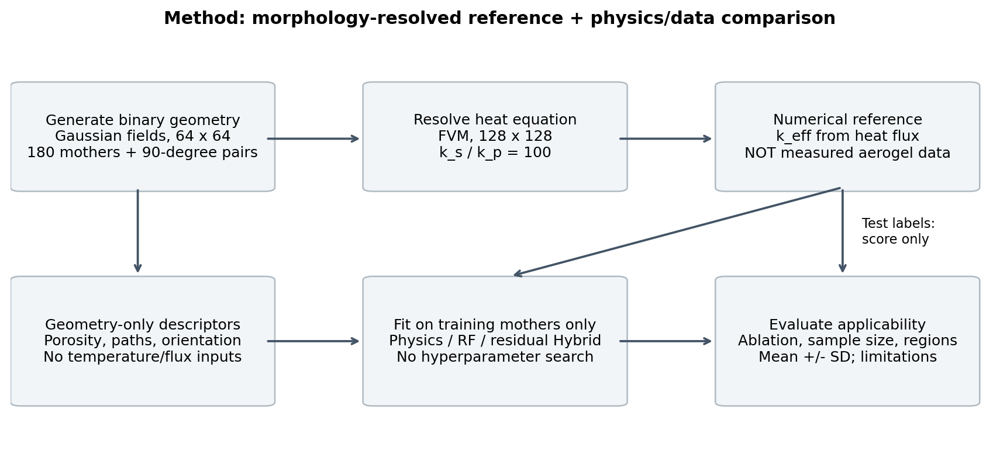

**图1 方法路线。所有特征从几何读取；测试标签只用于评分。**

# 6. 结果

## 6.1 结构信息有没有价值

同φ旋转对的FVM k分别为32.409和4.810，而孔隙率Physics均约16.115。这是路径方向导致约化误差的直接证据；其对应的是数值方向对照，不是现实制备因果实验。

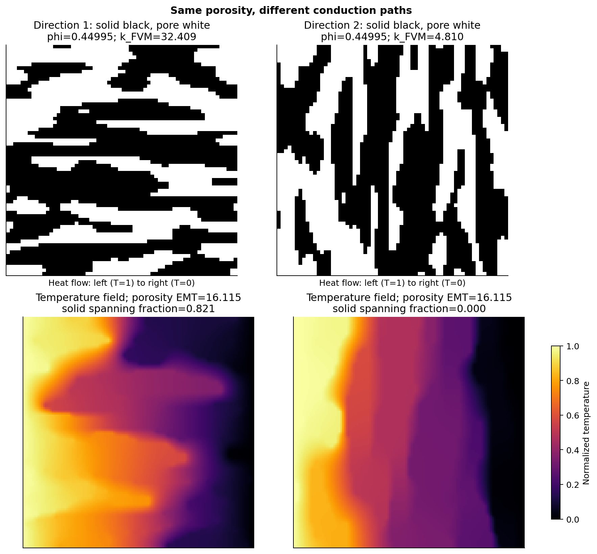

**图2 同φ但方向不同。高导热固相是否沿热流贯通改变有效导热。**

| 输入 | RF MAE mean ± SD |
| --- | --- |
| A0：只用φ | 4.817 ± 0.869 |
| A1：φ+孔尺度/界面 | 4.924 ± 0.872 |
| A2：全9项结构 | 1.657 ± 0.243 |

最终10划分A0→A2的MAE下降约65.6%，A1没有改善。早期5划分4.881→1.630（Hybrid 1.734）是保留的历史可行性结果，正文采用10划分4.817→1.657，不混作同一统计量。

置乱及移除诊断共同指向贯通、方向和截面路径：移除连通块后MAE为2.449，单独移除固相贯通为2.086。不能把65.6%的全部收益分配给一个变量，因为输入相关、替代关系明显。孔尺度/界面主要描述局部统计，缺少跨边界传热路径；本模型又没有Knudsen孔径机制，因此仅凭这些信息不足以补偿EMT。

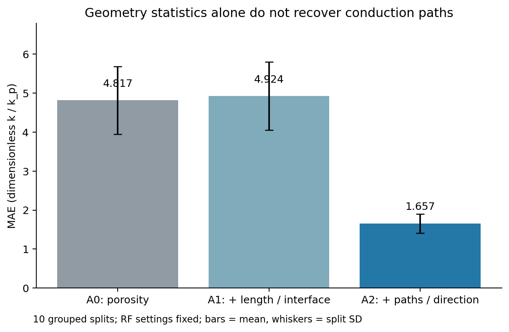

**图3 固定RF容量的输入消融；误差棒为10次group split的SD。**

## 6.2 同分布：RF与Hybrid均值接近

| 模型 | MAE mean ± SD | RMSE mean ± SD | R² mean ± SD |
| --- | --- | --- | --- |
| 孔隙率Physics | 5.131 ± 0.885 | 8.889 ± 1.121 | 0.602 ± 0.072 |
| 1p校准Physics | 4.835 ± 0.869 | 8.545 ± 1.131 | 0.631 ± 0.073 |
| 3p结构Physics | 2.632 ± 0.366 | 4.780 ± 0.583 | 0.883 ± 0.032 |
| RF | 1.657 ± 0.243 | 2.949 ± 0.397 | 0.956 ± 0.012 |
| Hybrid | 1.684 ± 0.298 | 2.980 ± 0.437 | 0.955 ± 0.010 |

校准控制仍有结构误差，3p Physics把MAE进一步降至2.632，直接RF为1.657，Hybrid为1.684。约0.027的均值差不足以支持稳定模型排名；第一个种子的测试母图配对bootstrap区间跨零。这表示当前证据不支持普遍优劣，不是正式等效性证明。

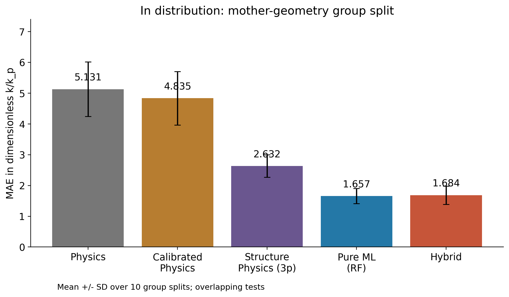

**图4 10次母结构分组留出；校准和半经验结构物理均是必要对照。**

## 6.3 中间φ=0.60缺口：Hybrid有条件优势

RF MAE为2.888，Hybrid为1.417，下降约50.9%；R²分别为0.219和0.823。10个森林种子都给出相同方向；首seed条件bootstrap的Hybrid−RF区间为[−1.849,−1.114]。

连续物理主干跨φ空白区间、结构残差仍有可迁移规律，是与结果相符的解释；没有做独立机制分解实验，不能把这一解释写成唯一证实的原因。一个中间层结果也不能推广为全部插值或OOD优势。

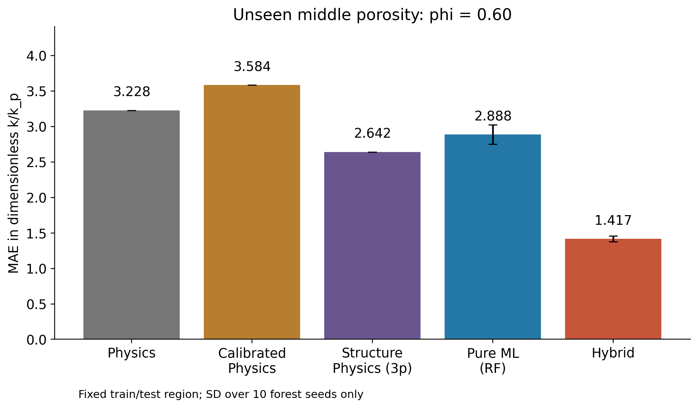

**图5 固定区域；误差棒只表示森林种子波动。**

## 6.4 φ=0.90真正外推：相极限有用

原Physics MAE为0.125，3p Physics为0.123，RF为0.897，Hybrid为0.391。两种物理控制都保留φ→1时k→k_p的极限；此处简单Physics已经足够，无需附加残差修正。

训练标签最低约1.525，测试均值约1.341、最低约1.150；RF叶平均不能低于训练标签最小值，首seed预测均值约2.246。Hybrid真实残差均值约0.121，学到的修正均值却约0.521，显示修正迁移偏大。

由于测试标签方差小，原Physics R²仍为−0.319，RF为−33.899、Hybrid为−15.398。负值不删除；较低MAE不意味着所有指标都“好”。该结果支持当前孔相主导极限下物理形式更稳，不支持“所有外推Physics必胜”。

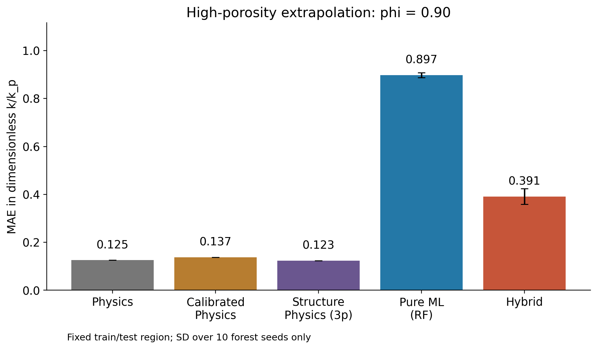

**图6 训练φ≤0.75、测试φ=0.90；没有把测试层用于重新校准。**

## 6.5 未见各向异性族：物理也必须包含必要结构

3p结构Physics MAE为3.175，优于RF的4.512和Hybrid的4.937。原孔隙率Physics约8.254，反而差于RF。方向指标全部超训练范围，树模型迁移困难；带少量方向/瓶颈信息的函数形式在本次迁移中更稳。

这个区别限制了“Physics更可靠”的表述：物理模型必须保留目标区域所需的结构关系。原Physics并非通用新结构族预测器，三参数形式也只是当前生成器条件下有效的半经验控制。

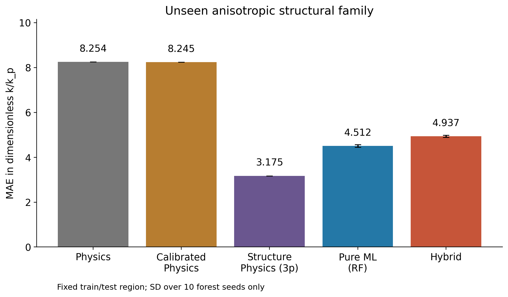

**图7 少参数结构模型与孔隙率模型不能混称。**

# 7. 失败与负结果

## 7.1 Hybrid没有稳定同分布优势

残差并非不可学：同分布残差RF测试R²约0.873，Hybrid将校准Physics的MAE从4.835降至1.684。但直接RF已利用相同9项几何信息。物理预测本身是φ的确定性函数；把它作为第10项加入RF，MAE为1.655，与原1.657接近。因此，有证据支持“额外物理输入在同分布信息上大体冗余”，而不是“ML无法学残差”。

## 7.2 没有稳定小数据优势

| 训练池比例 | RF MAE mean ± SD | Hybrid MAE mean ± SD |
| --- | --- | --- |
| 25% | 2.721 ± 0.523 | 2.948 ± 0.522 |
| 50% | 2.009 ± 0.268 | 2.078 ± 0.377 |
| 75% | 1.830 ± 0.217 | 1.818 ± 0.381 |
| 100% | 1.657 ± 0.243 | 1.684 ± 0.298 |

75%档Hybrid的平均优势仅约0.013，25%和50%反而较差。该设计未显示稳定的physics prior收益；不能事后推断“样本再少一点”或“再加更多数据”必然使Hybrid取胜。当前180母结构、三个生成族的覆盖也有限，未检验其他数据生成器下的学习曲线。

## 7.3 部分描述符没有收益，部分残差修正不迁移

A1局部孔尺度/界面统计未改善。高φ区域的修正偏大，以及未见族Hybrid较RF更差，说明残差随区域改变。平滑φ主干与复杂路径残差不是自动可分的通用物理定律；残差学习可能继承主干错误，也可能引入训练域特有的补偿。

同分布10划分的Hybrid出现1次负预测、3次串并联界限越界。这是包含重复测试样本的预测次数，不是独立材料数。全部保留，未裁剪以改善分数。含物理主干不保证最终输出物理可行，RF的高R²同样不能替代可行性检查。

## 7.4 真实气凝胶数据不能严格验证模拟规律

本地从Walker等对应的Aerogel_ML_Neo4j数据库[6]审计出73条/17个标题标准化论文组的筛查子集；实测孔隙率可用34条/8组。密度与k的pooled Spearman约0.618，实测φ与k约−0.448，与固相比例趋势方向相似。

然而测量温度、压力均缺失，材料化学与论文间偏移混杂，“average pore diameter”和“average pore size”也不等价；没有图像贯通或方向描述符。不能验证本文最关键的路径信息，也不能建立从模拟到实验的迁移精度。该检查只报告有限趋势，不重新训练一个现实模型。

公开仓库不分发许可不明的实验原表及逐行衍生数据。该附加检查需要用户自行取得原文件；默认主流程完整复现No.1。许可边界不是科学规律已被现实证实的替代证据。

# 8. 讨论：Physics / ML / Hybrid适用边界

| 区域 | 原Physics MAE | 3p Physics | RF | Hybrid |
| --- | --- | --- | --- | --- |
| 同分布分组 | 5.131 | 2.632 | 1.657 | 1.684 |
| 中间φ=0.60缺口 | 3.228 | 2.642 | 2.888 | 1.417 |
| 高φ=0.90外推 | 0.125 | 0.123 | 0.897 | 0.391 |
| 未见各向异性族 | 8.254 | 3.175 | 4.512 | 4.937 |

**Physics适用条件。** 已知解析极限、目标区接近孔相主导并且所需机制正确时，低参数Physics能避免训练标签范围限制。新结构族迁移中，当前3p结构Physics有优势；原孔隙率模型没有。Physics训练数据需求低，但本学习曲线没有证明“只要数据少Physics精度就最高”。

**Pure ML适用条件。** 目标来自被覆盖的生成族/φ层，有丰富、可靠的几何描述符时，直接RF能表达φ遗漏的路径作用，且同分布下优于这些简化物理控制。可进行快速代理预测，但本项目未实测大规模筛选加速，未知材料与3D环境不属于已验证范围。

**Hybrid适用条件。** 物理主干对目标区域有合适总体趋势，残差仍可学习且可迁移时，当前中间φ缺口表现出优势。相极限已足够准确时，残差反而可能偏大；面对新的方向族，物理分解本身也不能保证迁移。Hybrid提供一种表示与归纳偏置，不创造额外几何数据。

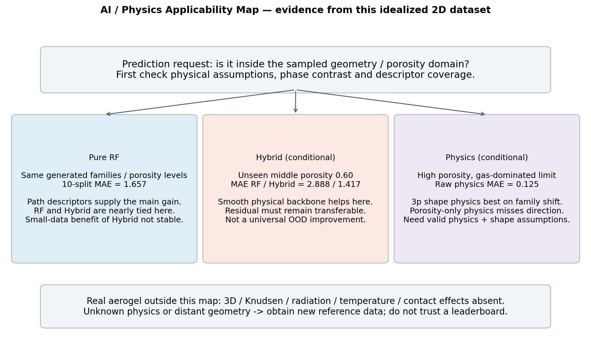

**图8 AI / Physics Applicability Map。这是当前理想二维数据的实验归纳，不是任意气凝胶的自动可信度判定器。**

三类模型更可靠的条件互相不同。判断新预测前，应先看物理假设、相导热率比、φ范围、方向和结构族是否匹配，再比较在对应域上的误差。不能只查一张平均排行榜。

# 9. 深度思考：AI最大的瓶颈是可信域识别

本项目在MacBook Air M4 CPU上完成全流程重算：原含外部Excel审计流程约43.4秒，公开No.1流程首次独立重算约38.5秒，均不含依赖安装。当前任务的瓶颈不是缺GPU，而是数据和模型是否覆盖目标问题。

第一，360幅图只有180母结构，且来自三个有限生成族，模型可能学到生成器规律。更多旋转或同源重复不等于独立材料多样性。第二，真实材料数据不只是少，还缺温压、成分和测试方向；不明条件不能由复杂模型补齐。第三，9个代理未充分表达三维路径、纳米气体、接触与辐射机制，缺失表示会限制所有数据方法。

第四，随机划分容易把“同源样本识别能力”误当“新域泛化”；分组及区域留出揭示了这一差别。第五，理想FVM与现实气凝胶存在domain gap，模拟的高分不说明实验可靠。第六，RF缺少解析极限，残差Hybrid也没有天然外推保证，精度和物理形式必须共同检查。

对材料AI而言，比进一步降低某个测试集误差更困难的问题，可能是**识别模型什么时候已经离开自己的可信预测域**。本项目只用范围/结构族诊断和条件适用图揭示这一问题，尚未构建自动OOD检测或校准的不确定性估计器，不把未来方法写成已完成贡献。

# 10. 局限性

本项目是二维局部Fourier稳态、完美接触、固定相导热率的数值验证。没有真实3D connectivity、纳米Knudsen抑制、辐射、温压依赖、气体种类变化、接触热阻、制备缺陷或材料化学。不能声称预测真实气凝胶高温性能。

FVM参考保留离散误差，网格细化只检查30例；几何生成器和描述符也具有边界约定。3p Physics属于半经验参数化，不能推广为严格机制定律。测试集的重叠、固定OOD区域与条件bootstrap限制统计范围。本项目不声称方法原创性、实验发现或全材料普适性。

# 11. 后续工作

后续扩展应依次补足目标问题需要的证据：由合成2D转向3D或真实重建骨架；由常数稳态导热转向温压相关、多机制传热；用测量条件完整、按来源分组的真实气凝胶数据验证。ML方面优先研究不确定性估计与OOD检测，明确什么时候应拒绝或提示低可信预测。

这些都是未来工作。本课程版本冻结，不以增加复杂网络或继续调参来掩盖当前负结果。

# 12. 可复现性与开放科学

公开仓库：https://github.com/Forever61T/porous-thermal-ai；版本：v1.0.0。科学计算代码快照：`e57e32cfd08474e9a5e4b684ab3a83e453bc2ab0`。最终交付commit由Release的v1.0.0 tag定位，完整发布回执另附。没有申请DOI，不编造持久标识符。

原创代码、合成数据规则/标签、全部No.1数字、分组计划、图表和报告公开；外部论文PDF、SI、作者源码、真实数据库及逐行处理记录以DOI或官方来源链接替代分发。代码MIT；原创合成数据、图表与报告CC BY4.0；第三方材料不自动继承这些许可。

正式平台为MacBook Air M4（Apple Silicon）、macOS27.0、Python3.12.14，8个固定直接依赖，包括NumPy2.3.5、pandas2.2.3、SciPy1.16.2、scikit-learn1.7.2与Matplotlib3.10.7；使用CPU，无CUDA/MPS/Metal训练逻辑。完整25包锁定清单、种子、原始/处理中间/结果的目录边界、单元测试及机器记录均可检查。

`python scripts/run_all.py`重建No.1图像/FVM标签、Physics/校准/3p/Ridge/RF/Hybrid、四组实验与科学图件，运行9测试并比较49行指标及70个计划。公开版首次重算38.5秒、最大指标差0；原干净venv完整本地重算43.4秒。它自动生成科学数据与图表，最终报告PDF是经审阅的版本文件，不宣称该命令自动完成文稿排版。耗时是本机测量，不承诺所有机器速度或逐位一致。

代码与文稿由Codex辅助实现和整理；本报告区分库提供的算法、独立实现和借鉴思路。提交者应阅读并核对内容、按课程要求披露辅助工具。项目无新材料实验或人/动物研究。作者姓名、学号及课程身份由提交者按提交格式填写；不代填未经确认的贡献、资助或声明。

# 结论

结构信息的收益主要来自跨边界传热路径与方向，而非一般孔尺度统计。直接RF与残差Hybrid在同分布下接近，Hybrid没有稳定小数据优势，但在本次中间φ缺口中有条件优势。高φ相极限下简单物理更稳；未见方向族中需要含结构关系的物理控制。AI的价值取决于它能补偿什么误差，以及这种误差关系在目标域中是否仍成立。

# 参考文献

[1] [Abraham Eldho, Cherpak Vladyslav, Senyuk Bohdan et al.. Highly transparent silanized cellulose aerogels for boosting energy efficiency of glazing in buildings. Nature Energy, 2023, 8: 381-396. DOI: 10.1038/s41560-023-01226-7.](https://doi.org/10.1038/s41560-023-01226-7)

[2] [Wei Han, Bao Hua, Ruan Xiulin. Machine learning prediction of thermal transport in porous media with physics-based descriptors. International Journal of Heat and Mass Transfer, 2020, 160: 120176. DOI: 10.1016/j.ijheatmasstransfer.2020.120176.](https://doi.org/10.1016/j.ijheatmasstransfer.2020.120176)

[3] [Bruggeman D. A. G.. Berechnung verschiedener physikalischer Konstanten von heterogenen Substanzen. I. Dielektrizitätskonstanten und Leitfähigkeiten der Mischkörper aus isotropen Substanzen. Annalen der Physik, 1935, 416: 636-664. DOI: 10.1002/andp.19354160705.](https://doi.org/10.1002/andp.19354160705)

[4] [Breiman Leo. Random Forests. Machine Learning, 2001, 45: 5-32. DOI: 10.1023/a:1010933404324.](https://doi.org/10.1023/a:1010933404324)

[5] [Lu Haofan, Yu Yi, Jain Ankit et al.. Deep learning techniques elucidate and modify the shape factor to extend the effective medium theory beyond its original formulation. International Journal of Heat and Mass Transfer, 2022, 184: 122305. DOI: 10.1016/j.ijheatmasstransfer.2021.122305.](https://doi.org/10.1016/j.ijheatmasstransfer.2021.122305)

[6] [Walker Rebecca C., Hyer Andres P., Guo Haiquan et al.. Silica Aerogel Synthesis/Process–Property Predictions by Machine Learning. Chemistry of Materials, 2023, 35: 4897-4910. DOI: 10.1021/acs.chemmater.2c03459.](https://doi.org/10.1021/acs.chemmater.2c03459)

[7] [Patankar S. V. Numerical Heat Transfer and Fluid Flow. CRC Press, 1980. ISBN 9780891165224.](https://www.routledge.com/Numerical-Heat-Transfer-and-Fluid-Flow/Patankar/p/book/9780891165224)

[8] [Pedregosa F., Varoquaux G., Gramfort A., et al. Scikit-learn: Machine Learning in Python. Journal of Machine Learning Research, 2011, 12: 2825–2830.](https://www.jmlr.org/papers/v12/pedregosa11a.html)

# 附录：冻结结果的补充图件

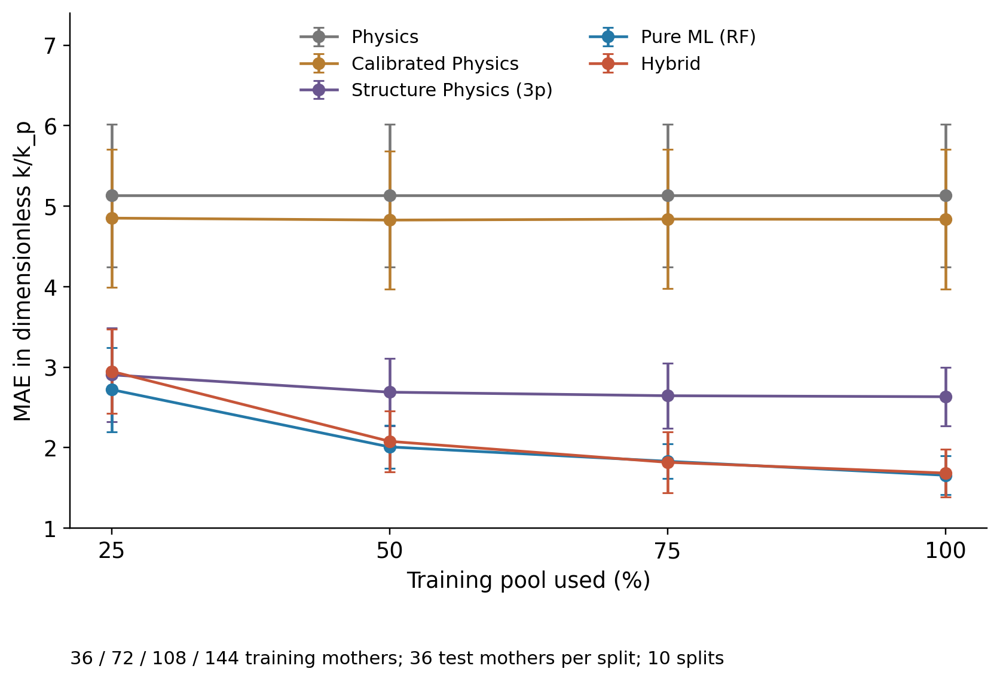

**附录A 36/72/108/144个训练母结构；误差棒为10次group split SD。**

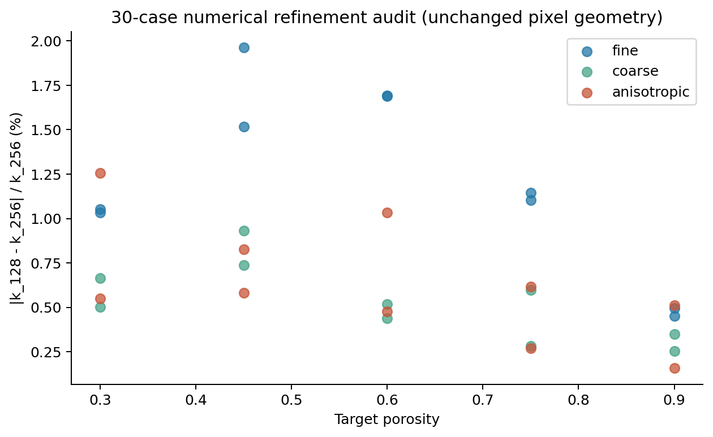

**附录B 同一像素几何的128与256格数值差异，不是实验误差。**

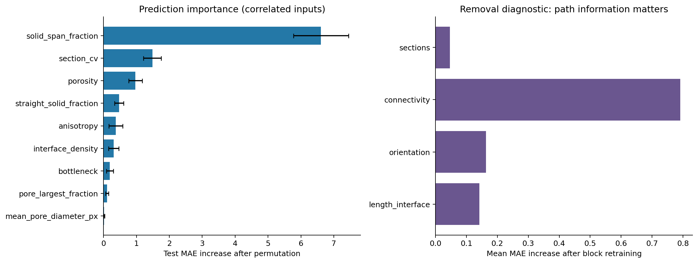

**附录C 相关输入下的预测诊断，不作独立因果贡献排序。**
